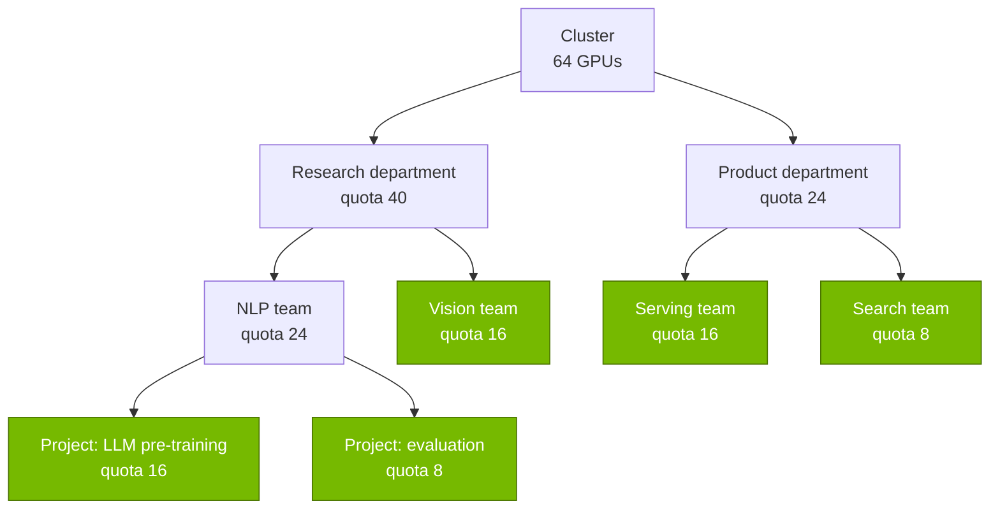
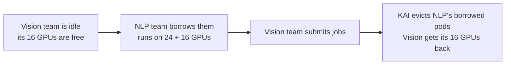
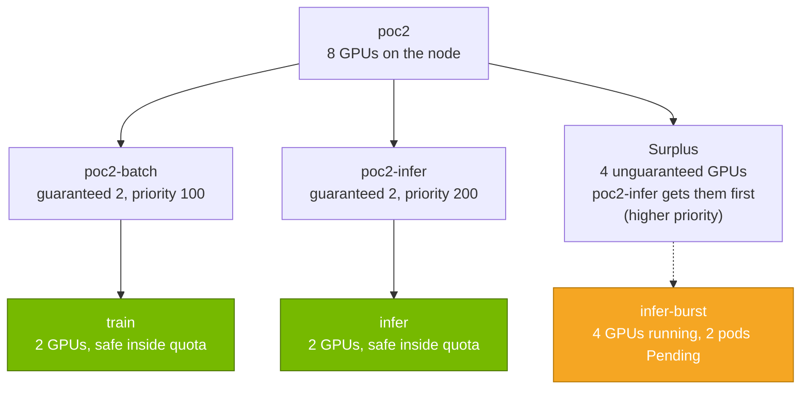

# KAI Scheduler Recipes

## How Queues Work

A KAI queue is a slice of the cluster's GPUs. Queues nest into a tree, so the same cluster can be divided between departments, then between teams, then between projects. Pods join a leaf queue with the label `kai.scheduler/queue: <name>`.



Green boxes are leaf queues, the ones pods are submitted to.

Each queue sets four knobs per resource:

* `quota`: GPUs the queue is guaranteed. A child's quota is carved out of its parent's.
* `limit`: the most GPUs it may ever use, including borrowed ones (`-1` means no cap).
* `priority`: which sibling gets idle GPUs first.
* `overQuotaWeight`: If two sibling queues have the same priority and one has this value set to 2, while the other is set to 1, surplus GPU capacity is split in a 2:1 ratio.

Guaranteed GPUs are never wasted. When a queue is idle, its siblings can borrow its GPUs, but only for preemptible workloads. When the owner submits work again, KAI reclaims the borrowed GPUs:



This lab uses two small trees from [`k8s/queues.yaml`](k8s/queues.yaml): `poc1` owns the whole node for Recipes 1 and 3, and `poc2` splits the node between two teams for Recipe 2.

## Recipe 1: Preemption inside One Queue

* `train` runs on 4 GPUs at priority `train` (50).
* `infer-burst` starts a Deployment of vLLM servers at priority `inference` (non-preemptible).
* Scaling `infer-burst` to 4 replicas keeps the node fully occupied.
* Scaling `infer-burst` further from 4 to 8 replicas makes KAI evict `train`.
* Scaling back to 4 frees its GPUs, and `train` resumes from its last checkpoint.
* `kubectl scale` stands in for an autoscaler.

```bash
kubectl get pods -w                                     # keep this open in a second terminal
kubectl apply -f k8s/dra/preemption/train.yaml               # train on 4 GPUs
kubectl apply -f k8s/dra/preemption/infer-burst.yaml         # 0 replicas
kubectl scale deployment infer-burst --replicas=4       # inference on the other 4 GPUs; node is full
kubectl logs -f -l job-name=train                       # wait for a model checkpoint save
kubectl scale deployment infer-burst --replicas=8       # load spike: train is evicted, a new pod waits in Pending
kubectl scale deployment infer-burst --replicas=4       # spike over: train resumes from the saved checkpoint on the freed GPUs
kubectl logs -f -l job-name=train | grep -i resuming

# Clean up
kubectl delete -f k8s/dra/preemption/infer-burst.yaml -f k8s/dra/preemption/train.yaml
rm -rf train/ckpts
```

## Recipe 2: Guaranteed GPUs and a Shared Surplus

* Queue `poc2` owns the node's 8 GPUs. `poc2-batch` and `poc2-infer` are each **guaranteed** 2; the other 4 are surplus.
* `train` runs on 2 GPUs, both from `poc2-batch`'s guaranteed quota.
* `infer` starts 2 vLLM servers on `poc2-infer`'s 2 guaranteed GPUs, at priority `inference` (non-preemptible).
* `infer-burst` scales to 6 more inference pods on the surplus, at priority `build-preemptible` (75). KAI only lets preemptible workloads go over quota.
* KAI gives all 4 surplus GPUs to `infer-burst`. The last 2 pods stay `Pending`, because `train`'s GPUs are within its guaranteed quota and can't be reclaimed.
* Though if `train` wasn't running and `poc2-batch`'s 2 guaranteed GPUs were free, infer-burst could use them as well and scale to all 8 GPUs.



Green pods run on guaranteed GPUs. Orange pods run on borrowed surplus and are preemptible.

```bash
kubectl get pods -o wide -w                            # keep this open in a second terminal
kubectl apply -f k8s/dra/queues-surplus/train.yaml          # train on its 2 guaranteed GPUs
kubectl apply -f k8s/dra/queues-surplus/infer.yaml          # infer gets 2 GPUs; train keeps running
kubectl apply -f k8s/dra/queues-surplus/infer-burst.yaml    # 0 replicas
kubectl scale deployment infer-burst --replicas=6           # 4 start, 2 stay Pending; train keeps running
kubectl logs -f deployment/infer                            # vLLM logs from one of the 2 replicas

# Clean up
kubectl delete -f k8s/dra/queues-surplus/infer-burst.yaml -f k8s/dra/queues-surplus/infer.yaml -f k8s/dra/queues-surplus/train.yaml
rm -rf train/ckpts
```

## Recipe 3: Fast Scaling w/ Dynamo Snapshot

* `checkpoint.yaml` starts one Gemma 3 4B worker, lets it load and compile, and checkpoints it to `dynamo-snapshot-pvc`. 
* `infer-burst.yaml` is a Dynamo deployment: an OpenAI-compatible frontend plus workers that restore the checkpoint instead of starting vLLM.
* `infer-burst-vllm.yaml` is a plain `vllm serve` Deployment, the cold-start baseline.
* **Scaling Gemma3 4B from 0 → 3 via** `vllm serve` **pods take about 95 s (about 170 s on the very first start, before vLLM has cached its compiled kernels); whereas scaling to 4 via Dynamo Snapshot takes 22 s, around 4x less.**

**One-time setup:** build the placeholder image and create the checkpoint as described in [`k8s/snapshot-setup.md`](k8s/snapshot-setup.md).

**Now, scale both and compare startup times.**

```bash
kubectl get pods -w                                        # keep this open in a second terminal
kubectl apply -f k8s/dra/snapshot/infer-burst.yaml              # frontend, 0 workers
kubectl apply -f k8s/dra/snapshot/infer-burst-vllm.yaml         # 0 replicas
kubectl patch dgdsa infer-burst-worker --type=merge -p '{"spec":{"replicas":4}}' && \
kubectl scale deployment infer-burst-vllm --replicas=3     # 7 GPUs in total
kubectl get events --field-selector reason=RestoreSucceeded  # one per restored worker

# Clean up
kubectl delete -f k8s/dra/snapshot/infer-burst-vllm.yaml -f k8s/dra/snapshot/infer-burst.yaml
```